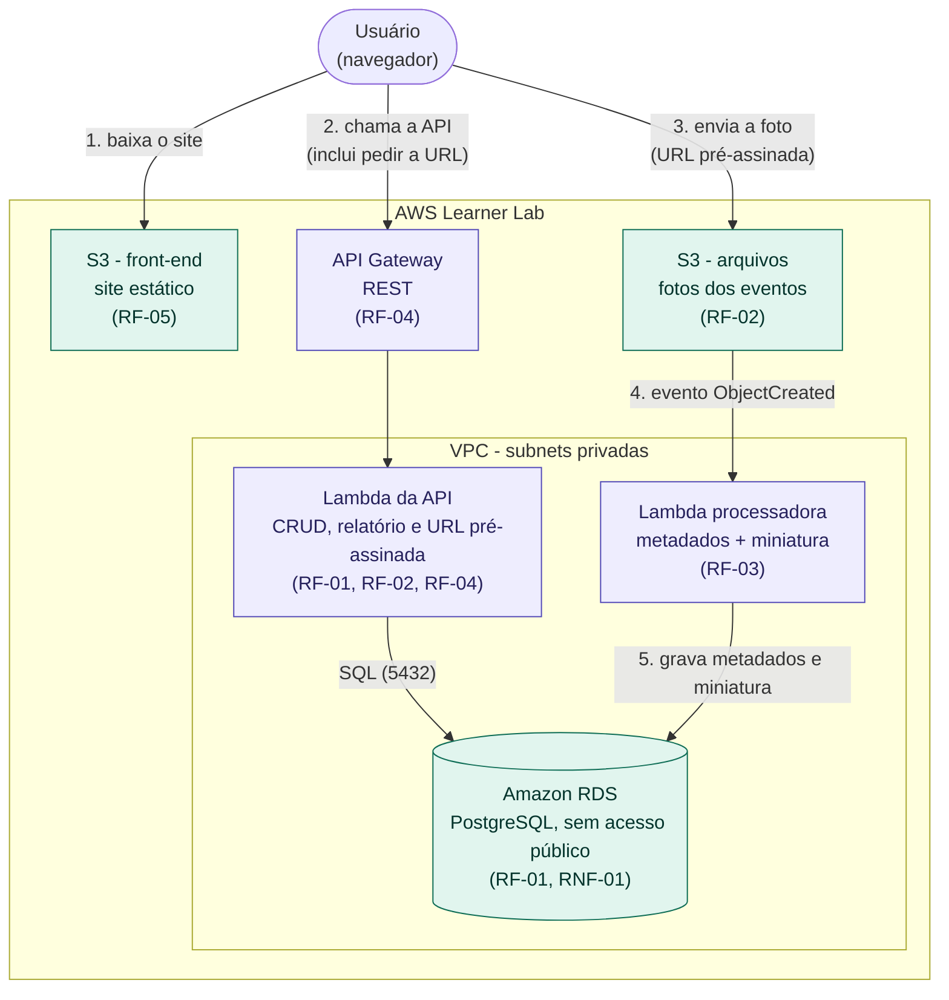

# Diagrama de arquitetura

**Legenda:** roxo = computação e API; verde = armazenamento e dados.

## Fluxos

| # | Fluxo | RF |
| --- | --- | --- |
| 1 | O navegador baixa o site estático do S3 | RF-05 |
| 2 | O navegador chama a API Gateway, que aciona a Lambda da API. Ela consulta o RDS e, quando necessário, gera a URL pré-assinada | RF-01, RF-02, RF-04 |
| 3 | O navegador envia a foto direto ao S3 com a URL pré-assinada | RF-02 |
| 4 | O S3 dispara a Lambda processadora a cada arquivo novo | RF-03 |
| 5 | A Lambda processadora grava metadados e miniatura no RDS | RF-03 |

A Lambda processadora lê a foto e grava a miniatura no S3 por um VPC Endpoint do tipo Gateway.

## 3. Modelo Entidade-Relacionamento
Seis entidades. evento tem uma auto-relação (evento_pai_id) para representar atividades vinculadas a um evento principal, e inscricao resolve a relação N:N entre evento e participante.

## ## 4. Rotas da API
 
Base URL configurável no front (`config.js`). Todas as respostas são JSON. Erros seguem o formato `{ "erro": "mensagem" }`.
 
### Locais (US01 · RF-01)
 
| Método | Rota | Corpo / parâmetros | Sucesso | Erros |
| --- | --- | --- | --- | --- |
| GET | `/locais` | `?ativo=true` (opcional) | 200 | |
| POST | `/locais` | `nome`, `localizacao`, `tipo`, `capacidade` | 201 | 400 campo faltando |
| GET | `/locais/:id` | | 200 | 404 |
| PUT | `/locais/:id` | mesmos campos do POST | 200 | 400, 404 |
| DELETE | `/locais/:id` | | 204 (desativa) | 404, 409 tem eventos futuros |
| GET | `/locais/:id/bloqueios` | | 200 | 404 |
| POST | `/locais/:id/bloqueios` | `inicio`, `fim`, `motivo` (opcional) | 201 | 400, 409 há evento no período |
| DELETE | `/locais/:id/bloqueios/:bloqueioId` | | 204 | 404 |
 
### Eventos e atividades (US02 a US06 · RF-01)
 
| Método | Rota | Corpo / parâmetros | Sucesso | Erros |
| --- | --- | --- | --- | --- |
| GET | `/eventos` | `?tipo`, `?de`, `?ate`, `?situacao` | 200 | |
| POST | `/eventos` | `titulo`, `tipo`, `modalidade`, `inicio`, `fim`, `local_id`, `vagas`, `link_acesso`, `evento_pai_id` (opcional) | 201 | 400, 409 conflito de horário, 422 vagas > capacidade |
| GET | `/eventos/:id` | | 200 (com atividades vinculadas) | 404 |
| PUT | `/eventos/:id` | mesmos campos do POST | 200 | 400, 404, 409, 422 |
| PATCH | `/eventos/:id/situacao` | `situacao` | 200 | 400, 404 |
| POST | `/eventos/:id/cancelamento` | | 200 | 404, 409 evento já realizado |
 
### Participantes e inscrições (US07 a US09 · RF-01)
 
| Método | Rota | Corpo / parâmetros | Sucesso | Erros |
| --- | --- | --- | --- | --- |
| POST | `/participantes` | `nome`, `email`, `ra` (opcional) | 201 | 400, 409 e-mail já cadastrado |
| GET | `/participantes/:id` | | 200 | 404 |
| POST | `/eventos/:id/inscricoes` | `participante_id` | 201 | 404, 409 duplicada ou lotado, 422 evento não aberto |
| GET | `/participantes/:id/inscricoes` | | 200 | 404 |
| DELETE | `/inscricoes/:id` | | 204 (cancela e libera vaga) | 404, 409 cancelamento não permitido |
 
### Arquivos (US10 · RF-02 e RF-03)
 
| Método | Rota | Corpo / parâmetros | Sucesso | Erros |
| --- | --- | --- | --- | --- |
| POST | `/eventos/:id/arquivos/upload-url` | `nome`, `tipo_mime` | 200 `{ url, chave_s3 }` | 400 formato não suportado, 404 |
| POST | `/eventos/:id/arquivos` | `chave_s3`, `nome_original`, `legenda` (opcional) | 201 | 404 |
| GET | `/eventos/:id/arquivos` | | 200 (com miniatura quando processada) | 404 |
 
### Relatórios (RF-04)
 
| Método | Rota | Corpo / parâmetros | Sucesso | Erros |
| --- | --- | --- | --- | --- |
| GET | `/relatorios/ocupacao` | `?de`, `?ate` (opcionais) | 200 `[{ local, evento, vagas, inscritos, taxa_ocupacao }]` | 400 período inválido |
 
A consulta do relatório usa `JOIN` entre `local`, `evento` e `inscricao` e `GROUP BY` por local e evento, com `LEFT JOIN` nas inscrições para que eventos sem inscritos apareçam com total zero.
 
## 5. Security Groups e rede
 
### Rede
 
| Recurso | Configuração |
| --- | --- |
| VPC | A VPC padrão do Learner Lab ou uma VPC dedicada, com pelo menos duas subnets privadas em zonas de disponibilidade diferentes (exigência do DB subnet group do RDS) |
| RDS | `Publicly accessible = No`, dentro das subnets privadas, sem rota para um Internet Gateway |
| Lambdas | Associadas às mesmas subnets privadas e ao `sg-lambda` |
| VPC Endpoint | Tipo Gateway para o S3, associado à route table das subnets privadas |
 
### Security Groups
 
**`sg-rds`** — anexado ao banco
 
| Direção | Protocolo / porta | Origem / destino | Motivo |
| --- | --- | --- | --- |
| Entrada | TCP 5432 | `sg-lambda` | Apenas as Lambdas conectam ao banco |
| Entrada | — | Nenhuma outra regra. Sem `0.0.0.0/0` | Sem acesso público (RNF-01) |
| Saída | — | Nenhuma regra necessária | O banco não inicia conexões |
 
**`sg-lambda`** — anexado às duas Lambdas
 
| Direção | Protocolo / porta | Origem / destino | Motivo |
| --- | --- | --- | --- |
| Entrada | — | Nenhuma | A Lambda é invocada pelo serviço, não recebe conexões |
| Saída | TCP 5432 | `sg-rds` | Consultas ao PostgreSQL |
| Saída | TCP 443 | Prefix list do S3 (via VPC Endpoint) | Ler a foto e gravar a miniatura |
 
**Acesso administrativo ao banco (a confirmar)**
 
Para criar as tabelas é preciso alcançar o RDS de dentro da VPC. As opções são rodar um script de criação do schema a partir de uma Lambda dentro da VPC ou usar uma instância EC2 temporária, com um `sg-admin` liberado na porta 5432 do `sg-rds`. O que for escolhido deve ser descrito no `README.md`, e o `sg-admin` removido depois do uso.
 
### Segredos (RNF-02)
 
A senha do banco não vai para o repositório. Ela é informada como variável de ambiente da Lambda ou guardada no Systems Manager Parameter Store, e o `README.md` explica como configurá-la.
 
## 6. Decisões arquiteturais (ADR)
 
### ADR-001 — O CRUD roda em Lambda ou em container? (RNF-04)
 
**Status:** proposta.
 
**Contexto.** O sistema precisa de uma camada de API para o CRUD de locais, eventos, participantes e inscrições. Já são obrigatórias uma Lambda disparada por arquivo novo no S3 (RF-03) e uma Lambda atrás do API Gateway para o relatório (RF-04). O banco fica em subnet privada, e o sistema precisa voltar a funcionar em uma nova sessão do Learner Lab seguindo o README, sem IP fixo no código (RNF-03). O protótipo atual tem backend em JavaScript.
 
**Opções consideradas.**
 
| | Lambda + API Gateway | Container (EC2 ou ECS) |
| --- | --- | --- |
| Servidor para manter | Nenhum | Sim: instância, imagem e deploy |
| Endereço estável a cada sessão | API Gateway mantém a URL | A instância pode mudar de IP |
| Aproveita o backend atual | Exige adaptar o código para handlers | Reaproveita quase direto |
| Consistência com os requisitos | Já usamos Lambda no RF-03 e no RF-04 | Passa a ter dois modelos de execução |
| Conexão com o banco | Uma conexão por instância da Lambda | Pool de conexões persistente |
| Custo no Learner Lab | Cobrança por uso, dentro do crédito | Instância ligada consome crédito continuamente |
 
**Decisão.** Usar Lambda para todo o CRUD, atrás do API Gateway.
 
**Consequências.**
 
- (+) Um único modelo de execução para toda a lógica de back-end e nenhum servidor para recriar a cada sessão do Learner Lab, o que simplifica o RNF-03.
- (+) A URL da API fica estável e entra no front por `config.js`.
- (−) É preciso adaptar o backend em JavaScript para o formato de handler da Lambda.
- (−) Cada instância da Lambda abre a própria conexão com o PostgreSQL. A conexão deve ser criada fora do handler para ser reutilizada, e o volume baixo do projeto não deve esgotar as conexões do RDS.
- (−) A Lambda na VPC exige VPC Endpoint para acessar o S3 e configuração de Security Groups, ambos documentados na seção 5.
Se a equipe preferir container, a "Lambda da API" do diagrama vira uma instância EC2 com Docker, o `sg-lambda` vira o SG da instância, e o restante da arquitetura não muda.
 
## 7. Rastreabilidade dos requisitos
 
| Requisito | Onde é atendido neste documento |
| --- | --- |
| RF-01 | Modelo ER (seção 3) e rotas de locais, eventos, participantes e inscrições (seção 4) |
| RF-02 | Rotas de arquivos e fluxo de upload (seções 2 e 4) |
| RF-03 | Lambda processadora e prefixos `uploads/` e `thumbs/` (seção 2); colunas preenchidas pela Lambda na tabela `arquivo` (seção 3) |
| RF-04 | Rota `/relatorios/ocupacao` (seção 4) |
| RF-05 | S3 como site estático (seções 1 e 2) |
| RNF-01 | RDS privado e Security Groups (seção 5) |
| RNF-02 | Segredos fora do repositório (seção 5) |
| RNF-03 | Lambda e API Gateway sem IP fixo (ADR-001); passo a passo no `README.md` |
| RNF-04 | ADR-001 (seção 6) |
| RNF-05 | Recursos criados pelo console ou CLI e documentados no `README.md` |
