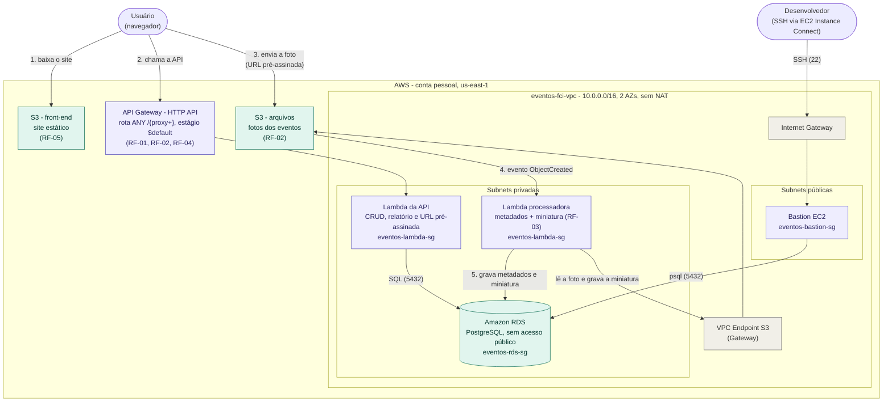

# Design do Projeto 2 — Sistema de Gestão de Eventos e Auditórios FCI
Este documento descreve como o sistema será construído na AWS (Learner Lab). Ele cobre o diagrama de arquitetura, o modelo de dados, as rotas da API, os Security Groups e as decisões arquiteturais (ADR).

## 1. Visão geral
O sistema é uma aplicação web em que o front-end estático, hospedado no S3, consome uma API exposta por um API Gateway (HTTP API) e implementada em funções Lambda. Os dados ficam em um PostgreSQL no Amazon RDS, em subnets privadas. As fotos dos eventos são enviadas direto ao S3 por URL pré-assinada, e cada foto nova dispara uma Lambda que extrai metadados e gera uma miniatura. O projeto roda em uma conta AWS pessoal, na região us-east-1.

| Camada | Serviço AWS | Papel |
| --- | --- | --- |
| Front-end | S3 (static website hosting) | Entrega HTML, CSS e JS do protótipo |
| Entrada da API | API Gateway (HTTP API) | Recebe todas as chamadas (RF-01, RF-02 e RF-04) e as encaminha à Lambda da API |
| Lógica de negócio | Lambda da API | CRUD, regras de conflito e capacidade, URL pré-assinada, relatório |
| Processamento | Lambda processadora | Metadados e miniatura de cada foto nova |
| Banco de dados | Amazon RDS (PostgreSQL) | Locais, eventos, participantes, inscrições e metadados dos arquivos |
| Arquivos | S3 (bucket de arquivos) | Fotos dos eventos e miniaturas |
| Rede | VPC `eventos-fci-vpc`, subnets públicas e privadas, Internet Gateway, VPC Endpoint do S3 | Isola o RDS e as Lambdas da internet pública |
| Acesso administrativo | Bastion EC2 na subnet pública | Aplicar o schema e consultar o banco privado |

## 2. Diagrama de arquitetura

 
**Legenda:** roxo = computação e API; verde = armazenamento e dados; cinza = rede.

### 3. Fluxos
 
| # | Fluxo | RF |
| --- | --- | --- |
| 1 | O navegador baixa o site estático do S3 | RF-05 |
| 2 | O navegador chama a Invoke URL do HTTP API, que aciona a Lambda da API. Ela consulta o RDS e, quando necessário, gera a URL pré-assinada | RF-01, RF-02, RF-04 |
| 3 | O navegador envia a foto direto ao S3 com a URL pré-assinada | RF-02 |
| 4 | O S3 dispara a Lambda processadora a cada arquivo novo | RF-03 |
| 5 | A Lambda processadora grava metadados e miniatura no RDS | RF-03 |
| — | O desenvolvedor entra no bastion por SSH (EC2 Instance Connect) e, dele, acessa o RDS na porta 5432 | RNF-01 |

## 4. Modelo Entidade-Relacionamento
Seis entidades. `evento` tem uma auto-relação (`evento_pai_id`) para representar atividades vinculadas a um evento principal, e `inscricao` resolve a relação N:N entre evento e participante. O schema executável está em `sql/01_schema.sql`.

### Regras de integridade
 
| Regra | Onde é garantida |
| --- | --- |
| Local físico exige capacidade (RN02) | Validação na Lambda da API |
| Dois eventos não podem se sobrepor no mesmo local (RN01) | Validação na Lambda da API (consulta de sobreposição) |
| Evento não pode ser marcado em período com bloqueio do local | Validação na Lambda da API |
| Vagas do evento não podem exceder a capacidade do local (RN02) | Validação na Lambda da API |
| Inscrições confirmadas não podem ultrapassar as vagas (RN03) | Validação na Lambda da API, dentro de transação |
| Um participante não se inscreve duas vezes no mesmo evento (RN06) | `UNIQUE (evento_id, participante_id)` |
| Inscrição cancelada pode ser reativada | `POST /eventos/:id/inscricoes` troca a situação para `confirmada` em vez de inserir outra linha |
| Local sem histórico é excluído; com histórico, é desativado | `DELETE /locais/:id` (coluna `local.ativo`) |
| Evento só é excluído se não tiver inscrições ativas | `DELETE /eventos/:id` |

## 5. Rotas da API
 
A base da API é a **Invoke URL do HTTP API**, no estágio `$default`, configurada no front em `config.js`. Todas as rotas chegam à Lambda da API pela rota `ANY /{proxy+}`. Todas as respostas são JSON, e os erros seguem o formato `{ "erro": "mensagem" }`.
 
### Locais (US01 · RF-01)
 
| Método | Rota | Corpo / parâmetros | Sucesso | Erros |
| --- | --- | --- | --- | --- |
| GET | `/locais` | `?ativo=true` (opcional) | 200 | |
| POST | `/locais` | `nome`, `localizacao`, `tipo`, `capacidade` | 201 | 400 campo faltando |
| GET | `/locais/:id` | | 200 (já traz os bloqueios do local) | 404 |
| PUT | `/locais/:id` | mesmos campos do POST | 200 | 400, 404 |
| DELETE | `/locais/:id` | | 204. Sem histórico: exclui de verdade. Com histórico: desativa | 404, 409 tem evento futuro |
| GET | `/locais/:id/bloqueios` | | 200 | 404 |
| POST | `/locais/:id/bloqueios` | `inicio`, `fim`, `motivo` (opcional); `?forcar=true` bloqueia mesmo com eventos no período | 201 | 400, 409 há evento no período (sem `forcar`) |
| DELETE | `/locais/:id/bloqueios/:bloqueioId` | | 204 | 404 |
 
### Eventos e atividades (US02 a US06 · RF-01)
 
| Método | Rota | Corpo / parâmetros | Sucesso | Erros |
| --- | --- | --- | --- | --- |
| GET | `/eventos` | `?tipo`, `?de`, `?ate`, `?situacao`, `?local_id`, `?principal=true` (só eventos principais) | 200 | |
| POST | `/eventos` | `titulo`, `descricao`, `tipo`, `modalidade`, `inicio`, `fim`, `local_id`, `vagas`, `link_acesso`, `permite_cancelamento`, `evento_pai_id` (opcional) | 201 | 400, 409 conflito de horário, 422 vagas > capacidade |
| GET | `/eventos/:id` | | 200 (com atividades vinculadas) | 404 |
| PUT | `/eventos/:id` | mesmos campos do POST | 200 | 400, 404, 409, 422 |
| PATCH | `/eventos/:id/situacao` | `situacao` | 200 | 400, 404 |
| POST | `/eventos/:id/cancelamento` | | 200 `{ atividades_canceladas, inscricoes_canceladas }` | 404, 409 evento já realizado |
| DELETE | `/eventos/:id` | | 204 (exclusão definitiva) | 404, 409 há inscrições ativas |
 
### Participantes e inscrições (US07 a US09 · RF-01)
 
| Método | Rota | Corpo / parâmetros | Sucesso | Erros |
| --- | --- | --- | --- | --- |
| GET | `/participantes` | | 200 | |
| POST | `/participantes` | `nome`, `email`, `ra` (opcional) | 201 | 400, 409 e-mail já cadastrado |
| GET | `/participantes/:id` | | 200 | 404 |
| PUT | `/participantes/:id` | mesmos campos do POST | 200 | 400, 404, 409 e-mail já cadastrado |
| POST | `/eventos/:id/inscricoes` | `participante_id` | 201 | 404, 409 duplicada ou lotado, 422 evento não aberto |
| GET | `/eventos/:id/inscricoes` | | 200 | 404 |
| GET | `/participantes/:id/inscricoes` | | 200 | 404 |
| DELETE | `/inscricoes/:id` | | 204 (cancela e libera vaga) | 404, 409 cancelamento não permitido |
 
### Arquivos (US10 · RF-02 e RF-03)
 
| Método | Rota | Corpo / parâmetros | Sucesso | Erros |
| --- | --- | --- | --- | --- |
| POST | `/eventos/:id/arquivos/upload-url` | `nome`, `tipo_mime` | 200 `{ url, chave_s3 }` | 400 formato não suportado, 404 |
| POST | `/eventos/:id/arquivos` | `chave_s3`, `nome_original`, `legenda` (opcional) | 201 | 404 |
| GET | `/eventos/:id/arquivos` | | 200 (com miniatura quando processada) | 404 |
 
### Relatórios (RF-04)
 
| Método | Rota | Corpo / parâmetros | Sucesso | Erros |
| --- | --- | --- | --- | --- |
| GET | `/relatorios/ocupacao` | `?de`, `?ate` (opcionais) | 200 `[{ local, evento, vagas, inscritos, taxa_ocupacao }]` | 400 período inválido |
 
A consulta do relatório usa `JOIN` entre `local`, `evento` e `inscricao` e `GROUP BY` por local e evento, com `LEFT JOIN` nas inscrições para que eventos sem inscritos apareçam com total zero.
 
## 5. Security Groups e rede
 
### Rede
 
| Recurso | Configuração |
| --- | --- |
| VPC | `eventos-fci-vpc`, `10.0.0.0/16`, região `us-east-1`, 2 zonas de disponibilidade |
| Subnets | 2 públicas e 2 privadas (uma de cada tipo por zona) |
| Internet Gateway | Anexado à VPC. Só a route table das subnets públicas tem rota para ele |
| NAT | Não há. As subnets privadas não têm saída para a internet |
| RDS | `Publicly accessible = No`, nas subnets privadas (DB subnet group com as duas zonas), com `eventos-rds-sg` |
| Lambdas | Nas subnets privadas, com `eventos-lambda-sg` |
| VPC Endpoint | Tipo Gateway para o S3, associado à route table das subnets privadas |
| Bastion | Instância EC2 na subnet pública, com `eventos-bastion-sg` |
 
### Security Groups
 
A AWS não aceita nomes de Security Group que comecem com `sg-`, por isso os nomes reais usam o prefixo `eventos-`.
 
**`eventos-rds-sg`** — anexado ao banco
 
| Direção | Protocolo / porta | Origem / destino | Motivo |
| --- | --- | --- | --- |
| Entrada | TCP 5432 | `eventos-lambda-sg` | As Lambdas conectam ao banco |
| Entrada | TCP 5432 | `eventos-bastion-sg` | O bastion aplica o schema e consulta o banco |
| Entrada | — | Nenhuma outra regra. Sem `0.0.0.0/0` | Sem acesso público (RNF-01) |
| Saída | — | Nenhuma regra necessária | O banco não inicia conexões |
 
**`eventos-lambda-sg`** — anexado às duas Lambdas
 
| Direção | Protocolo / porta | Origem / destino | Motivo |
| --- | --- | --- | --- |
| Entrada | — | Nenhuma | A Lambda é invocada pelo serviço, não recebe conexões |
| Saída | TCP 5432 | `eventos-rds-sg` | Consultas ao PostgreSQL |
| Saída | TCP 443 | Prefix list do S3 (via VPC Endpoint) | Ler a foto e gravar a miniatura |
 
**`eventos-bastion-sg`** — anexado ao bastion
 
| Direção | Protocolo / porta | Origem / destino | Motivo |
| --- | --- | --- | --- |
| Entrada | TCP 22 | Prefix list gerenciada do EC2 Instance Connect (`us-east-1`) | SSH liberado apenas para o serviço de conexão da AWS, sem expor a porta 22 à internet |
| Saída | TCP 5432 | `eventos-rds-sg` | Acessar o banco com o `psql` |
| Saída | Padrão do SG | Internet | Instalar o cliente `psql` na instância |
 
### Acesso administrativo ao banco
 
O RDS é privado e não pode ser alcançado do computador do desenvolvedor. O acesso é feito por um **bastion EC2** na subnet pública: o desenvolvedor entra por SSH usando o EC2 Instance Connect e, do bastion, executa o `psql` contra o RDS para aplicar `sql/01_schema.sql` e conferir os dados.
 
### Segredos (RNF-02)
 
A senha do banco **não vai para o repositório**. Ela é informada como **variável de ambiente da Lambda**. O Parameter Store e o Secrets Manager foram descartados porque, com a Lambda em subnet privada e sem NAT, exigiriam um Interface Endpoint pago (ver ADR-003). O `README.md` explica como configurar a variável.
 
## 6. Decisões arquiteturais (ADR)
 
### ADR-001 — O CRUD roda em Lambda ou em container? (RNF-04)
 
**Status:** aceita.
 
**Contexto.** O sistema precisa de uma camada de API para o CRUD de locais, eventos, participantes e inscrições. Já são obrigatórias uma Lambda disparada por arquivo novo no S3 (RF-03) e uma Lambda atrás do API Gateway para o relatório (RF-04). O banco fica em subnet privada, e o sistema precisa poder ser recriado do zero seguindo o README, sem IP fixo no código (RNF-03). O protótipo anterior não tinha backend: o front-end falava direto com o Supabase, então a camada de API é escrita do zero de qualquer forma.
 
**Opções consideradas.**
 
| | Lambda + API Gateway | Container (EC2 ou ECS) |
| --- | --- | --- |
| Servidor para manter | Nenhum | Sim: instância, imagem e deploy |
| Endereço estável | O API Gateway mantém a URL | A instância pode mudar de IP ao ser parada e iniciada |
| Reaproveitamento de código | Não há backend a reaproveitar, então não pesa | Não há backend a reaproveitar, então não pesa |
| Consistência com os requisitos | Já usamos Lambda no RF-03 e no RF-04 | Passa a ter dois modelos de execução |
| Conexão com o banco | Uma conexão por instância da Lambda | Pool de conexões persistente |
| Custo | Cobrança por uso, sem custo com o serviço ocioso | Instância ligada gera custo contínuo |
 
**Decisão.** Usar Lambda para todo o CRUD, atrás do API Gateway.
 
**Consequências.**
 
- (+) Um único modelo de execução para toda a lógica de back-end e nenhum servidor para manter ou recriar, o que simplifica o RNF-03.
- (+) A URL da API fica estável e entra no front por `config.js`.
- (−) Cada instância da Lambda abre a própria conexão com o PostgreSQL. A conexão deve ser criada fora do handler para ser reutilizada, e o volume baixo do projeto não deve esgotar as conexões do RDS.
- (−) A Lambda na VPC exige VPC Endpoint para acessar o S3 e configuração de Security Groups, ambos documentados na seção 5.

Se a equipe preferir container, a "Lambda da API" do diagrama vira uma instância EC2 com Docker, o `eventos-lambda-sg` vira o SG da instância, e o restante da arquitetura não muda.

### ADR-002 — HTTP API em vez de REST API no API Gateway
 
**Status:** aceita.
 
**Contexto.** O API Gateway oferece dois tipos de API: REST API e HTTP API. Toda a lógica de roteamento e validação já está no código da Lambda da API, e o front-end está em outro domínio (o site do S3), o que exige CORS.
 
**Opções consideradas.**
 
| | HTTP API | REST API |
| --- | --- | --- |
| Custo | Menor | Maior |
| Configuração | Mais simples | Mais etapas (recursos, métodos, deploy de estágio) |
| CORS | Nativo, configurado na própria API | Configurado método a método |
| Roteamento para a Lambda | Uma rota `ANY /{proxy+}` leva tudo ao handler | Exige mapear recursos e métodos |
| Recursos exclusivos | Não tem chaves de API, planos de uso nem validação de requisição | Tem, mas o projeto não usa |
 
**Decisão.** Usar HTTP API, com a rota `ANY /{proxy+}` apontando para a Lambda da API e o estágio `$default`.
 
**Consequências.**
 
- (+) Menos configuração e menor custo, com CORS resolvido na própria API.
- (+) A lista de rotas fica documentada na seção 4 e implementada no código, sem duplicar a definição no API Gateway.
- (−) O roteamento e a validação das requisições ficam por conta da Lambda.
- (−) Se o projeto passar a precisar de chaves de API ou planos de uso, será necessário migrar para REST API.
### ADR-003 — Senha do banco em variável de ambiente, e não no Secrets Manager
 
**Status:** aceita.
 
**Contexto.** A Lambda precisa da senha do banco (RNF-02: nenhuma senha ou chave no repositório). A Lambda está em subnet privada, sem NAT. Para ler um segredo do Secrets Manager ou do Parameter Store a partir dessa subnet, seria necessário criar um Interface Endpoint, que é cobrado por hora.
 
**Opções consideradas.**
 
| | Variável de ambiente da Lambda | Secrets Manager ou Parameter Store |
| --- | --- | --- |
| Custo | Nenhum | Interface Endpoint pago (e o próprio Secrets Manager cobra por segredo) |
| Complexidade | Baixa | Mais recursos e permissões |
| Rotação de senha | Manual | Possível de automatizar |
| Exposição | Visível no console para quem tem acesso à função | Acesso controlado por permissão |
 
**Decisão.** Guardar a senha em variável de ambiente da Lambda, fora do repositório.
 
**Consequências.**
 
- (+) Sem custo adicional e sem novos recursos de rede.
- (+) Atende ao RNF-02: a senha não aparece no código nem no repositório. O `README.md` descreve como configurá-la.
- (−) Quem tem acesso à configuração da função consegue ler a senha.
- (−) A troca da senha é manual. Em um ambiente de produção, o caminho seria migrar para o Secrets Manager e arcar com o custo do endpoint.
 
## 7. Rastreabilidade dos requisitos
 
| Requisito | Onde é atendido neste documento |
| --- | --- |
| RF-01 | Modelo ER (seção 3) e rotas de locais, eventos, participantes e inscrições (seção 4) |
| RF-02 | Rotas de arquivos e fluxo de upload (seções 2 e 4) |
| RF-03 | Lambda processadora e prefixos `uploads/` e `thumbs/` (seção 2); colunas preenchidas pela Lambda na tabela `arquivo` (seção 3) |
| RF-04 | Rota `/relatorios/ocupacao` (seção 4) |
| RF-05 | S3 como site estático (seções 1 e 2) |
| RNF-01 | RDS privado, subnets e Security Groups (seção 5) |
| RNF-02 | Segredos fora do repositório (seção 5 e ADR-003) |
| RNF-03 | Lambda e API Gateway sem IP fixo (ADR-001 e ADR-002); passo a passo no `README.md` |
| RNF-04 | ADR-001 (seção 6) |
| RNF-05 | Recursos criados pelo console ou CLI e documentados no `README.md` |
